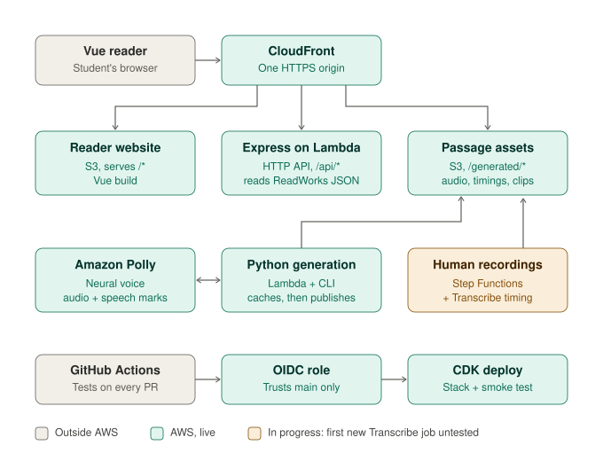

# SoundWorks final presentation

Team 48 · AWS Breaking Barriers hackathon · Thursday, Nov 5, 2026

- **Theme:** Community Empowerment (digital tools that enhance educational access)
- **Judging:** Technical Capability · User Interface and Design · Impact & Scalability · Originality & Uniqueness
- **Schedule:** preliminary presentations 10:00–12:00; finals NYC 1:40, DC 2:20, Seattle 3:00
- **Live site:** https://d1381qenwhm2qw.cloudfront.net
- **Hard limit:** 10:00 including Q&A. Plan 7:30 of talking, leaving 2:30 for the judges' questions.

Prepared Nov 4 from the code on `main` (after PR #17) and a walkthrough of the live site. Re-check anything marked with a PR number if that PR merges before you present.

---

## 1. Minute-by-minute outline

Speakers are suggestions based on who built what; swap freely.

| Time | Segment | Suggested speaker | What to cover | Criteria |
|---|---|---|---|---|
| 0:00–0:30 | Team intro | Cindy | "We're Team 48: Cindy, Yufei, Sri, Sanjana and Emily. We built SoundWorks for ReadWorks." One line each on role. | — |
| 0:30–1:15 | Problem + theme | Sanjana | ReadWorks has 6,893 passages, and 888,147 students use its audio each week. 64% of passages use computer audio and 36% have human narrators. Students with reading or attention difficulties need to hear the passage *and* follow along. Community Empowerment: free, in the browser, no login. | Impact |
| 1:15–2:00 | Solution overview | Cindy | A natural voice reads the passage. Every word lights up as it's spoken, and the page scrolls to keep up. Tap any word to read from there or hear just that word. Supports: grade-based speed tip, text size, dyslexia font, Color Focus, keyboard and screen reader. | Originality, UI |
| 2:00–3:00 | Architecture | Yufei (serving + deploys), Sri (generation) | Walk the diagram top to bottom (talking points below). | Technical |
| 3:00–6:30 | Live demo | Cindy drives, one teammate narrates | Script in section 3 (3:30). | UI, Technical, Originality |
| 6:30–7:15 | Impact + scalability | Sanjana | Section 4: "scales with passages, not listeners". | Impact & Scalability |
| 7:15–7:30 | Close | Cindy | Known limits in one breath (section 5), then "Thank you, happy to take questions." | — |
| 7:30–10:00 | Judges' Q&A | Everyone | Section 6. | — |

---

## 2. Architecture (as built)

For slides: [architecture-diagram.svg](architecture-diagram.svg), or [architecture-diagram.png](architecture-diagram.png) for Google Slides, which doesn't import SVG. The SVG is hand-written text, so edit it directly; regenerate the PNG after any change.

### Talking points (60 s)

- **One origin.** The reader, the API and the audio all come from one CloudFront address. That means no cross-origin setup, and every bucket stays private behind origin access control.
- **Audio is prepared once, never per student.** Uploading a passage's JSON to `passages/` triggers a Python Lambda (or the team runs `generation/generate.py`). It asks Polly Neural for the audio, then separately for word "speech marks" (when each word starts). It also records each unique word on its own for "Hear just that word". Long passages are split under Polly's 3,000-character limit and stitched back together, with timings shifted to match.
- **Cache first.** Before calling Polly, it checks a cache keyed on the text and settings, so an unchanged passage costs nothing. Files are published audio first and manifest last, then a `current.json` pointer switches. A student never gets audio and timings from different versions.
- **The reader runs on one audio clock.** Every control (play, seek, speed, tap a word, replay sentence) drives one audio element. The highlight is computed from its current time, so it stays right through seeks and speed changes.
- **Human recordings keep their voice.** We don't re-voice the 36% of passages that have a human narrator. Amazon Transcribe finds when each word is spoken, and we match that to ReadWorks' approved text; words we can't time are left unhighlighted rather than guessed. Step Functions waits between checks, so no Lambda sits idle while Transcribe works. *In progress:* the workflow ran live in AWS on Nov 4 and published the caretaker passage, but both runs reused an already-saved transcript. A brand-new (paid) Transcribe job hasn't been run yet.
- **Every merge deploys itself.** Pull requests run API, reader and Python tests plus a CDK synth. A merge to `main` re-runs them, then GitHub Actions gets short-lived AWS credentials through OIDC (no keys stored in GitHub), runs `cdk deploy`, and smoke-tests the live site.

Details: [architecture](architecture.md) · [generation](generation.md) · [human audio](human-audio.md) · [CI/CD](ci-cd.md) · [deployment](deployment.md) · [cost](cost.md)

---

## 3. Live demo script (3:30)

### Before going on stage

- [ ] **No writes to the demo passages until after the finals.** Since PR #17, a published `current.json` pointer outranks the pinned demo recordings. Running `generate.py --bucket` for `demo`, or queueing `park-caretaker` or `park-caretaker-qa`, changes the live demo at once, and redeploying the site doesn't undo it. If someone regenerates `demo` tonight to add word clips, walk the whole script again afterwards.
- [ ] Presentation laptop, **Chrome**, a **fresh Guest or Incognito window**. The site remembers settings per browser: the speed tip appears only the first time, and Color Focus, text size, font, Highlight and "Tap a word to" stay as you left them.
- [ ] Sound through the room speakers; test the volume with the first sentence.
- [ ] Browser zoom about 125% so the back row can read it.
- [ ] Tab 1 on https://d1381qenwhm2qw.cloudfront.net ("A Morning in the Garden"). **Don't open the caretaker passage yet**: step 8 opens it so the speed tip appears.
- [ ] A backup screen recording of this script on the desktop, in case Wi-Fi fails.
- [ ] Nothing below needs a sign-in or the AWS console.

### Steps

| # | Time | Do | Say |
|---|---|---|---|
| 1 | 0:00 | Press **Play**. Let paragraph 1 play. | "A natural neural voice reads the passage, and every word lights up as it's spoken." |
| 2 | 0:20 | Tap **"bird"**. | "Lost your place? Tap any word and it reads from there." |
| 3 | 0:35 | In the middle of "Then the sun appeared…", press **Replay sentence**. Let "Brrr!" go by. | "Replay sentence goes back to the start of the sentence you're on." If anyone reacts to "Brrr!": "Sound words like that are a known weak spot for the voice. It's on our limits list." |
| 4 | 0:55 | Pause. Set **Tap a word to → Hear just that word**. Tap **"sunrise"**. | "For decoding practice, a student can hear one word on its own. The passage waits where it was." |
| 5 | 1:15 | Click the **Highlight** switch off, then on. Press **Tab** once (an amber outline shows focus is on the passage), press **→** a few times, then **Enter**. | "Students who find the moving highlight distracting can turn it off. Everything works from the keyboard: arrow keys move word by word, screen readers announce each one, and Enter reads from there. Screen readers hear the passage as normal sentences, not 49 separate buttons." |
| 6 | 1:45 | Text size: the biggest **Aa**. **Dyslexia font** on. Press **Start over**. | "Larger text and a dyslexia-friendly font. The page scrolls by itself to keep the spoken word in view, and the audio bar stays on top." |
| 7 | 2:15 | Text size back to the second **Aa** (100%), Dyslexia font off. Turn on the **Color Focus** switch (bottom of the reading settings). Press **Start over**. When it stops after paragraph 1, click **Keep going**. Click **Cream**. | "Color Focus is for students with attention difficulties. It puts a soft tint behind the passage, highlights the sentence being read, dims other paragraphs, and stops after each paragraph so they can take a breath. 'Part 1 of 2 done.' The student decides when to keep going. Tints include blue, green and cream." |
| 8 | 2:55 | Turn **Color Focus** off. Open https://d1381qenwhm2qw.cloudfront.net/?passage=park-caretaker-qa in a new tab. Wait for "Are you in 1st grade?", click **Change to 0.5×**, then Play for a few seconds. | "This is a real ReadWorks passage read by ReadWorks' own human narrator. The site knows it's a 1st-grade passage and suggests a slower speed, without making a new recording. The highlighting comes from Amazon Transcribe matched to the approved text, run by our Step Functions workflow. The note says some words aren't highlighted; that's honest: 356 of 360 are." |
| 9 | 3:15 | Pause. Hover over **nature** until the definition card opens. Press **☆ Add to My words**, then open **Vocabulary**. | "Students can explore a word without interrupting the reading. Official ReadWorks words are underlined; their own starred words stay in this browser." |
| 10 | 3:30 | Pause. | Hand over to the impact speaker. |

**If you're running long,** drop step 6 first, then the keyboard part of step 5.

**If something goes wrong**

- No speed tip in step 8: this browser has already answered it, or Play was pressed first. Open a new Guest window, or skip it and say "first-time visitors get a grade-based speed tip."
- "Hear just that word" catches the start of the next word: "That's why we now record each word separately; this demo recording predates that."
- The page doesn't scroll in step 6 on a big screen (the whole passage fits): drop the scrolling line, or point it out during step 8.
- The text shows but says "Audio is temporarily unavailable", or there's no sound at all: reload once, then switch to the backup recording.

---

## 4. Impact talking points (45 s)

Source: [cost.md](cost.md) (AWS Polly prices checked Nov 4, 2026; library figures from the ReadWorks Vision document).

- **Generate once, reuse forever.** Audio is made once per passage and cached. Students listening trigger no new Polly charges, so 888,147 students a week cost the same in Polly as one.
- **About $640 to narrate the whole library once, with word timing** (20 million characters × 2 requests at $16 per million). That's about 9 cents for an average passage.
- **About $410 if only the 64% of passages with computer voices are redone.** The 36% with human narrators keep their voice; we add highlighting with Transcribe, paid once per recording and saved for reuse. (Transcribe isn't included in these figures.)
- **Honest comparison:** ReadWorks' stated current cost is $4 per million characters; ours is $32 (8×), because it buys a natural voice *plus* word timing. Neural audio without highlighting would be about $320.
- **Storage is about $1 to $1.25 a month** for the whole library.
- **Only changes cost money.** New or edited passages regenerate; unchanged ones reuse the cache. This was verified in the sandbox: an unchanged re-upload used zero new characters.
- **Scales without servers.** No VMs or database. CloudFront serves from the edge, generation runs when a passage is uploaded, and every merge deploys itself.
- **Access:** works in any browser, including school Chromebooks and phones (checked at phone width), with no login. Reading preferences and starred vocabulary stay in that browser; there is no student account or server-side word list.

Keep these caveats ready but don't lead with them. The $640 doesn't count per-word clips (shared by every passage, not measured yet), CloudFront, Lambda or S3 request costs, or Polly's free tier.

---

## 5. Known limits (say them before a judge does)

1. **The live demo recording predates per-word clips.** "Hear just that word" on it cuts the word out of the passage recording. Per-word clips are built and merged (PR #13); they appear once someone with AWS access regenerates the demo passage, which is one command.
2. **"Brrr!" sounds robotic.** Sound words are a known weak spot for Polly Neural.
3. **Human-recording automation is still in progress.** It runs live in AWS, but only with an already-saved transcript so far; a first new Transcribe job hasn't been tried. In the caretaker passage, 4 of 360 words aren't highlighted because Transcribe merged or skipped them.
4. **Single words use their dictionary pronunciation,** so homographs like "read" and "live" can come out wrong.
5. **Definitions have gaps.** Vocabulary uses learner definitions from Simple English Wiktionary, with English Wiktionary as a fallback. Some names and sound words have no entry. My words are saved only in this browser, per passage. English only; Question Set is hidden.

---

## 6. Q&A prep (one-breath answers)

- **Why not slow the voice down when generating?** Polly's slower rates sounded poor in our listening tests, so we keep one recording and let the browser change speed. The grade tip suggests 0.5× through grade 4 and 0.75× for grades 5–8.
- **How accurate is the highlighting?** For Polly, the word times come from Polly itself for the same text, and generation refuses to publish if any word is missing. For human recordings, it's Transcribe timestamps matched to the known text; words we can't time are left unhighlighted rather than guessed.
- **What happens when ReadWorks edits a passage?** The cache key includes the text, so only that passage regenerates. The `current.json` pointer switches once all the new files are in place.
- **Why WAV and not MP3?** WAV lets us stitch long passages together precisely without extra audio tools. MP3 can come later without changing the timing format.
- **Security?** All buckets are private behind CloudFront, and generation has no public endpoint. Deploys use short-lived OIDC credentials that only `main` can get, with no AWS keys in GitHub.
- **Student privacy?** No accounts and no database. Preferences and My words are stored only in the student's own browser. Dictionary requests send the selected word, with no student identifier.
- **Other languages?** Not yet. The ReadWorks import accepts English passages only today, though Polly has neural voices in other languages.
- **What's next?** Regenerate the library with per-word clips, run a first new Transcribe job on a small approved recording, improve vocabulary coverage, add account sync for My words, and build question activities.

---

## 7. Rehearsal notes from the live walkthrough (Nov 4)

Every step in the script worked on the live site after PR #17 deployed:

- play, word highlighting, follow-along scrolling and "Back to where we're reading"
- Read from there, Replay sentence, and Hear just that word (it pauses in place)
- the Highlight switch, text size and the dyslexia font
- Color Focus: tints, sentence highlight, dimming, the pause after each paragraph, and Keep going
- the speed tip on `park-caretaker-qa`
- keyboard navigation and the screen-reader structure
- phone width, with no sideways scrolling

Playback and highlighting were checked through the page's state, not by ear, so **listen to every step in rehearsal**.

- **The speed tip never appears on the default demo passage,** because it has no grade. Use `?passage=park-caretaker-qa` (1st grade → 0.5×). The older `?passage=park-caretaker` also works but highlights only 347 of 360 words.
- **The speed tip appears once per browser and closes as soon as you press Play.** Show it before playing, in a fresh window.
- **"Hear just that word" on the demo** slices the passage recording, because it has no per-word clips yet. A word followed by a pause, such as "sunrise." or "can.", should cut most cleanly; check by ear.
- **Justified text at 175–200%** leaves big gaps between words (`apps/reader/src/style.css`, `.passage { text-align: justify }`). It's cosmetic, but left-aligned text is usually easier for dyslexic readers.
- **During the Color Focus pause, the next paragraph's first word is already highlighted.** That's intended: it marks where Keep going will start.
